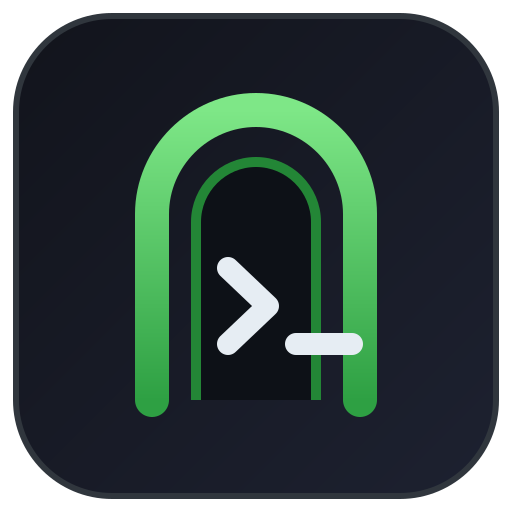

# opencode-zen-gate



An [opencode](https://opencode.ai) plugin that keeps outgoing requests to the **OpenCode Zen free tier** in the shape the server-side gate expects.

Use it when you point opencode at the Zen endpoint through **your own provider id** (self-hosted gateway, new-api, a custom `baseURL`) — opencode only adds the `x-opencode-*` headers for provider ids that start with `opencode`. The plugin also patches tool schemas that would otherwise trip the gate.

- **Constrained syntax**: fully synchronous, no module imports, no `BigInt`, no `crypto` — it survives plugin sandboxes that reject `async` and `import`.
- **Single file**: `plugin.js`, no dependencies.

## Install

```jsonc
// opencode.json
{
  "$schema": "https://opencode.ai/config.json",
  "plugin": [
    ["opencode-zen-gate", { "providers": ["opencode", "zen-gateway"] }]
  ],
  "provider": {
    "zen-gateway": {
      "npm": "@ai-sdk/openai-compatible",
      "name": "Zen via /inference",
      "options": {
        "baseURL": "https://opencode.ai/inference/v1",
        "apiKey": "public"
      },
      "models": { "space-bunny-free": { "name": "Space Bunny Free" } }
    }
  }
}
```

Or reference the file directly:

```jsonc
{ "plugin": [["./node_modules/opencode-zen-gate/plugin.js", { "providers": ["zen-gateway"] }]] }
```

## Options

| Option | Default | Meaning |
| --- | --- | --- |
| `providers` | `["opencode"]` | Provider ids whose requests get the Zen headers |
| `userAgent` | `opencode/1.19.0` | Prefix only — the AI SDK appends its own suffix, so do not add it here |
| `fillEmptyToolProperties` | `true` | Give tools with an empty `jsonSchema.properties` a placeholder property |
| `log` | `false` | Print what was injected to stderr |

## What the gate checks (2026-10)

All six must hold for `POST https://opencode.ai/inference/v1/chat/completions`:

1. `Authorization: Bearer public`
2. `User-Agent` parses as `opencode/<version>` with `version >= 1.18.0` (below that: `426 UpgradeRequired`)
3. `x-opencode-session` present
4. `x-opencode-session-id` present **and structurally valid**: `ses_` + 12 hex + 14 base62, where the low 12 bits of the hex are `>= 0xfc0` (the descending id from `packages/schema/src/identifier.ts`, i.e. `counter <= 64`)
5. body `stream: true`
6. body `tools`: a tool named `read` must exist, and every tool in the file-tool family (`bash`, `read`, `edit`, `write`, `glob`, `grep`) that is present must have a non-empty `parameters.properties`

The plugin covers 2, 3, 4 and the schema half of 6. opencode already streams, and `read` is on by default — if you disable `read` for an agent, the gate will reject the request and no plugin can fix that.

## Notes

- The plugin writes `output.jsonSchema`, **not** `output.parameters`. Replacing `parameters` makes the registry drop `jsonSchema` and you lose the real schema.
- Built-in tools expose a zod-like `parameters` object with `jsonSchema === null`; the plugin leaves those untouched.
- Header hooks are merged last in `session/llm/request.ts`, so the injected values win.

## 中文说明

这是 opencode 插件：当你把 Zen 端点接到**自建 provider id**（自建网关 / new-api / 自定义 `baseURL`）时，
opencode 不会自动补 `x-opencode-*` 头，本插件负责补上，并顺手修补会让闸门拒绝的空 tool schema。

闸门六条判据、判据 4 的来历（`0xfc0` 边界）、以及逐条实测证据，见配套文档：
<https://github.com/WU-HINS/opencode-zen-gate> 的 README 与源仓库分析记录。

## Assets

`icon.svg` is the **official opencode app favicon**, taken byte-for-byte from upstream
`packages/ui/src/assets/favicon/favicon.svg` at `v1.19.0` (612 bytes). No modification.
opencode and its logo are the property of their owners; it is included here only to identify
the plugin's host application. Replace it if you prefer a neutral icon.

## License

MIT (plugin code). The bundled icon follows upstream's license.
